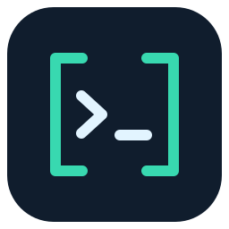

# CTFCode · 本地 CTF 工作台

**独立 OpenCode TUI + Strata + GSQ-RCO Coder IQ1_M。** 把本地模型、题目目录、运行状态和会话归档放进同一个终端工作台，不再让下载用户拼一堆脚本。

> **[下载 Windows x64 便携包 · preview.4](https://github.com/tianrenu/CTFCode/releases/tag/v0.1.0-preview.4)**
>
> 下载 `CTFCode-v0.1.0-preview.4-windows-x64.zip`，不是 Source code。完整解压后双击 **`CTFCode.exe`**。不必另装原版 OpenCode、Python、Bun 或 npm；模型权重另下。

[使用指南](docs/便携版使用.md) · [模型下载与校验](docs/模型下载与校验.md) · [引擎版本与来源](docs/引擎下载与配置.md) · [构建与验收](docs/TUI整合进度.md)

## 打开之后是什么？

直接进入原生 TUI 开始页，而不是另一个外部目录输入脚本或 Web 做题台：

| 开始页步骤 | 做什么 |
| --- | --- |
| ① 配置本地模型 | 选择已有模型目录，原地复用，不搬运权重 |
| ② 校验与准备 | 首次只有两个GGUF时，在界面里确认校验并准备pack；可看进度、报错和取消 |
| ③ 打开题目文件夹 | 新建空白会话，旧记录独立保存在原题目目录 |
| ④ 启动本地模型 | 按需加载；状态、上下文与资源都在同一TUI内管理 |

小型 `CTFCode.exe` 有独立源码、项目图标和版本信息，约11KB，不是把原版OpenCode改名。原3/7号BAT仅为旧用户保留兼容，不再是对外主入口。

## 日常操作

| 操作 | 命令 |
| --- | --- |
| 开始页 / 控制中心 | `/ctf setup` / `/ctf` |
| 加载 / 停止并卸载 | `/ctf start` / `/ctf stop` |
| 32K默认 / 64K候选 | `/ctf 32` / `/ctf 64` |
| 换题 / 同目录换方向 | `/cd "题目完整路径"` / `/new` |
| 准备进度 / 自检 | `/ctf progress` / `/ctf status` |
| 正常归档退出 | `/exit` |

每次打开、切换或重开目录都从空白上下文开始，不自动恢复旧消息。旧会话留在原目录的 `.ctfcode/会话归档`，可人工查阅；附件、脚本与成果不删除。切换时的目录或归档检查失败会明确报错，不静默丢记录。

## 包里有什么，还缺什么？

- **已包含：** 源码编译的定制 OpenCode `2.3.0-ctfcode.2`、CTF插件与控制器、Python、Strata Control、32K/64K两档签名引擎、pefile/Capstone/Unicorn和许可。
- **另下：** 模型IQ1_M两个分片，合计约58.4GB；[指南](docs/模型下载与校验.md)给出固定revision、官方/镜像直链、大小和SHA256。已有完整目录可直接复用。
- **不包含：** 权重、packs、本机设置、会话、赛题、解题成果与测试日志。

整个文件夹必须保持完整，不要单独移动EXE。当前未作代码签名，请核验发布页SHA256和来源；本项目不要求关闭系统防护或绕过安全提示。

## 适用范围与真实边界

参考机器：Windows x64、RTX 5060 Laptop 8GB、32GB RAM、SSD。需要兼容NVIDIA驱动；启动器使用受支持Windows 10/11内置.NET Framework 4.x，无需.NET SDK。保留单模型、RAM/VRAM/工作集与进程树保护，不关闭其他应用，不修改桌面版OpenCode，服务端口18791不占用Burp的8080。

- 参考机器已验证32K真实生成、脚本执行/读回、卸载重载，64K短生成与运行中停止，以及压缩后续聊、退出归档与空白新会话。
- 本轮入口回归：Python60通过/2跳过，Node46通过/1跳过；实际从新便携布局启动EXE并操作原生开始页，正常退出。
- **64K仍是候选。** 不承诺近满窗口长期稳定、恒定10+ token/s或复杂CTF独立解题。
- 另一台干净电脑的首次58.4GB完整pack准备尚未实测；首次准备失败/取消回归不等于这项成功。
- 权限规则不是OS沙箱。仅用于授权环境；未知PE应在虚拟机或受限仿真中分析，不直接运行。

## 源码、构建与致谢

[定制CLI构建](docs/定制CLI构建.md)记录上游固定版本、补丁、编译器与SHA256；`script/launcher.py`构建小型入口，`script/portable.py`白名单生成便携包。二进制只作为Release资产，不提交模型或本机文件。

本项目基于[OpenCode](https://github.com/anomalyco/opencode)，保留原作者署名与[MIT许可证](LICENSE)。仓库历史源码快照为1.2.26；实际定制CLI由构建锁从2.3.0源码编译，不能把旧源码树误当作当前EXE构建版本。模型、Strata、CUDA与分析依赖分别遵守其许可，见指南与包内 `licenses/`。

旧preview.1/2/3发布与失败记录保留，不覆盖。完整部署资料见[文档索引](docs/README.md)。
